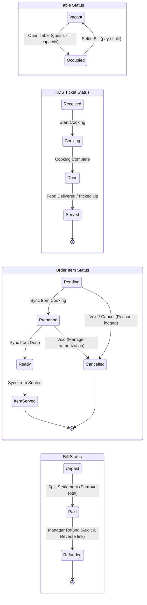

# Dining Reservation, KDS State Machine, and Split Settlement

## 1. System Scope and Domain Boundaries

TableCraft (Dining) is the restaurant management domain of Business Suite. It owns table topology, guest reservations, table sessions, QR and staff ordering, kitchen display system (KDS) ticketing, bill calculation with service charges, split settlement, and refund processing.

This document formalizes the transaction boundaries, multi-tenant isolation, state machine invariants, and rollback conditions for Dining P1 core functionality in accordance with `HARNESS.md`, `CONSTRUCTION.md`, and `DEVELOP_PLAN.md`.

## 2. Transaction Boundaries and Atomic Operations

All dining domain mutations are executed inside scoped database transactions (`*sql.Tx`) with explicit rollbacks on error:

### 2.1 Table Reservation Boundary (`/api/stations/dining/service` - `action: reserve`)
- **Inputs**: `tableId`, `customerName`, `customerPhone`, `guestCount`, `reservationTime`, `idempotencyKey`.
- **Validation**:
  1. Look up table within the current tenant (`organization_id = ?`). Return 404 if not found.
  2. Validate `guestCount <= table.capacity`. Reject with 409 Conflict if guest count exceeds capacity.
  3. Validate 90-minute time window conflict:
     `julianday(reservation_time) < julianday(?, '+90 minutes') AND julianday(reservation_time, '+90 minutes') > julianday(?)`
     If any confirmed reservation overlaps, reject with 409 Conflict.
- **Execution**:
  1. Insert into `dining_reservations` with status `'confirmed'`.
  2. Record idempotency key and audit log.
  3. Commit transaction atomically.

### 2.2 Table Session & Concurrency Boundary (`/api/stations/dining/table` - `action: open`)
- **Inputs**: `tableId`, `guests`, `idempotencyKey`.
- **Validation**:
  1. Table must exist, belong to tenant, be in `status = 'vacant'`, and have `guests <= capacity`.
  2. Table must have zero active sessions (`status = 'active'`). Reject with 409 Conflict if already occupied.
- **Execution**:
  1. Insert `dining_table_sessions` row with `status = 'active'`.
  2. Update `dining_tables` status to `'occupied'` with optimistic guard (`status = 'vacant'`). Ensure exactly one row affected.
  3. Record idempotency key and audit log.
  4. Commit transaction atomically.

### 2.3 KDS Ticket & Item State Machine (`/api/stations/dining/business`)
- **Inputs**: `ticketId`, `expected` (optional or current), `next` (target status).
- **Invariants**:
  - Ticket progression: `received` -> `cooking` -> `done` -> `served`.
  - Item progression: `pending` (`ordered`) -> `preparing` -> `ready` -> `served`.
  - Strict unidirectional flow: illegal jumps (e.g. `received` directly to `served`) or backwards transitions (e.g. `served` to `cooking`) are rejected (409 Conflict on state machine violation / 400 on malformed input).
  - Terminal state `served`: once served, the ticket cannot be transitioned again.
- **Execution**:
  1. Read ticket and item status with tenant check. If missing, return 404.
  2. Verify expected status matches database state. If mismatched, return 409 Conflict.
  3. Update ticket status in `dining_kitchen_tickets` and order item status in `dining_order_items`.
  4. If all tickets of a takeout order are served, mark the order as `completed`.
  5. Commit transaction atomically.

### 2.4 Split Settlement & Service Fee Conservation (`/api/stations/dining/table` - `action: pay`)
- **Inputs**: `sessionId`, `expectedTotal`, `splitCount` or `splits` array, `method`, `idempotencyKey`.
- **Invariants**:
  - Subtotal equals the sum of uncancelled line totals: `subtotal = SUM(dining_order_items.line_total)`.
  - 10% service fee calculation: `fee = (subtotal * rate + 50) / 100` (e.g., subtotal 300, 10% rate -> fee = 30, total = 330 as specified in D07).
  - Split conservation: the sum of all split amounts must equal `total` exactly (`sum(splits) == total`).
  - No rounding loss: when splitting by `splitCount`, remainder `total % splitCount` is distributed to the initial splits, ensuring zero penny loss.
- **Execution**:
  1. Verify session is `active`. Read billable items.
  2. Verify `expectedTotal == total`. Reject with 409 Conflict if bill changed.
  3. Create `dining_bills` row with `status = 'paid'`, `subtotal`, `service_charge`, `final_amount`, and `paid_amount = total`.
  4. Insert `dining_payments` rows for each split index with respective payment method.
  5. Close session (`status = 'closed'`, `closed_at = CURRENT_TIMESTAMP`).
  6. Release table (`status = 'vacant'`).
  7. Mark orders as `completed`.
  8. Commit transaction atomically.

### 2.5 Refund Processing & Reverse Audit Trail (`/api/stations/dining/service` - `action: refund`)
- **Inputs**: `orderId` or `billId`, `reason`, `idempotencyKey`.
- **Invariants**:
  - Role requirement: `admin` (Dining Manager) required.
  - Bill must be in `status = 'paid'` and `paid_amount > 0`.
  - Duplicate refund prevention: if already refunded, reject with 409 Conflict.
  - Reverse audit link: payment record inserted with negative amount (`-paid_amount`), method `'mock_refund'`, and `bill_id` referencing the original bill.
  - Bill status updated to `'refunded'`, `paid_amount = 0`.
  - Order status updated to `'cancelled'`; unserved kitchen tickets closed.
  - Full audit event logged with before/after state and reason.

## 3. Multi-Tenant Isolation

1. Every database query includes `organization_id = id.OrganizationID`.
2. Cross-tenant access to foreign tables, sessions, tickets, orders, or bills produces `sql.ErrNoRows` and returns 404 Not Found (or 403 Forbidden for unauthorized roles).
3. Idempotency keys are strictly scoped by `(organization_id, key, endpoint)`. A tenant cannot observe or replay another tenant's idempotency records.

## 4. State Machine Diagram

## 5. Rollback and Failure Modes

1. **Capacity Exceeded**: Aborted before any write; returns 409 Conflict.
2. **Overlapping Reservation**: Query conflict detected; rolled back, returns 409 Conflict.
3. **Stale Bill / Concurrent Payment**: Session active check or expectedTotal mismatch detected; rolled back, returns 409 Conflict.
4. **Illegal KDS Transition**: State machine guard fails; rolled back, returns 409 Conflict.
5. **Duplicate Refund**: Bill status already `'refunded'`; rolled back, returns 409 Conflict.
6. **SQLite Write Interruption**: Immediate `defer tx.Rollback()` prevents partial records.
